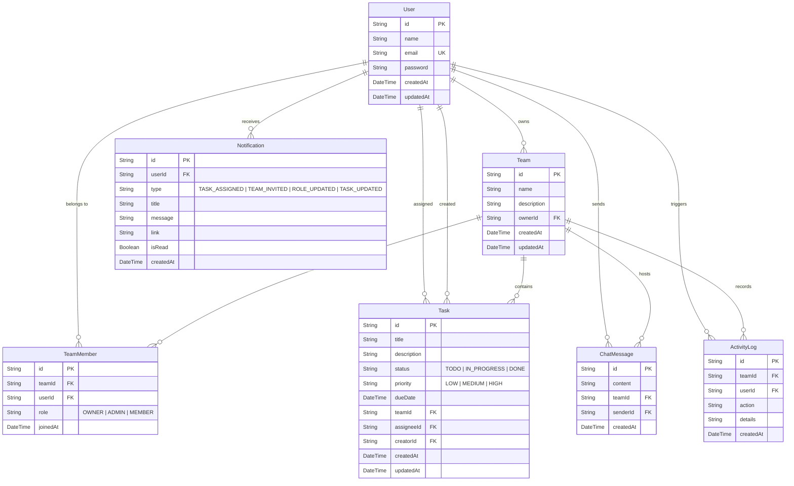

# TaskFlow - Task & Team Management Application

> **Assignment 3 & 4: Task & Team Management App: Real-time Collaboration & Advanced Features**  
> Built with Next.js (App Router, Route Handlers, TypeScript), Prisma ORM, PostgreSQL (Supabase), Real-time Collaboration (WebSockets & SSE Stream), and Tailwind CSS.

---

## 🚀 Live Demo & Links
- **GitHub Repository**: [https://github.com/an2obanhmi/SDN302_1](https://github.com/an2obanhmi/SDN302_1)
- **Deployed Website (Vercel)**: *(Configured on Vercel)*
- **Separate Backend URL (NestJS on Render)**: N/A
- **Real-time mechanism used**: Supabase Realtime / Server-Sent Events (SSE) & WebSockets

---

## 📋 Submission Information (Required Labels)

```text
Student ID: __________
Full Name: __________
GitHub Repository URL: https://github.com/an2obanhmi/SDN302_1
Deployed Website URL (Vercel): __________
Separate Backend URL (NestJS on Render) — write N/A if not used: N/A
Real-time mechanism used (Supabase Realtime / Socket.io / Pusher / Ably): Supabase Realtime (with WebSockets & SSE multi-transport fallback)
Test Account 1 Email: grader@test.com
Test Account 1 Password: Grader123@
Test Account 2 Email (must be on the SAME team as Account 1, to test real-time between two sessions): alice@test.com
Test Account 2 Password: Alice123@
Both test accounts are already email-verified / ready to log in immediately, with no confirmation link needed (Yes / No): Yes
Demo video link (YouTube/Drive/Loom, 2–3 minutes, showing live chat and live task updates across two sessions): __________
```

---

## 🔑 Test Accounts for Real-time Dual-Session Testing

Both accounts are pre-seeded on the **same team** (`Core Engineering Team`) to effortlessly test live updates across two browser windows:

| Role | Account Email | Password | Permissions Summary |
|---|---|---|---|
| **Owner** | `grader@test.com` | `Grader123@` | Full control: manage members, change roles, delete team, delete any task |
| **Admin** | `alice@test.com` | `Alice123@` | Can manage members and all tasks, but cannot delete the team |
| **Member** | `bob@test.com` | `Bob123@` | Can create tasks, manage own assigned/created tasks, view all data & chat |

*Self-registration also works with instant login (no email confirmation needed).*

---

## ⚡ Real-Time Collaboration Architecture

TaskFlow implements a multi-transport pub/sub real-time architecture:
1. **Real-time Team Chat**: Each team features a dedicated chat room with persisted message history in PostgreSQL (`ChatMessage`), real-time delivery without page refresh, and typing indicators.
2. **Live Task Board Updates**: Task creation, editing, status changes, and deletion immediately broadcast to all online team members via `team-${teamId}` channels, reflecting live on both the Kanban board and Table view.
3. **In-App Notification Bell**: Instant alerts dispatched to user personal channels (`user-${userId}`) when assigned a task, invited to a team, or role-changed. Unread badge counter updates live with mark-as-read controls.
4. **Multi-Transport Reliability**: Supports native **Supabase Realtime** (`@supabase/supabase-js`) and **Pusher** WebSockets, paired with built-in **Server-Sent Events (SSE)** stream (`/api/teams/[id]/events` and `/api/notifications/events`) ensuring real-time features work out-of-the-box in any environment.

---

## 🗄️ Relational Database Schema & ERD

Connected to cloud **PostgreSQL** on Supabase using **Prisma ORM**.



---

## 🔒 Advanced Role & Permission Matrix (RBAC)

| Action | Unauthenticated | Member | Admin | Owner |
|---|:---:|:---:|:---:|:---:|
| View Landing Page, Public Task CRUD | ✅ | ✅ | ✅ | ✅ |
| Access Dashboard & Teams | ❌ | ✅ | ✅ | ✅ |
| Create Team | ❌ | ✅ *(Becomes Owner)* | ✅ *(Becomes Owner)* | ✅ *(Becomes Owner)* |
| Update Team Name & Description | ❌ | ❌ | ✅ | ✅ |
| Delete Team | ❌ | ❌ | ❌ *(Protected)* | ✅ *(Owner Only)* |
| Add Members by Email | ❌ | ❌ | ✅ | ✅ |
| Change Member Role | ❌ | ❌ | ✅ *(Member ↔ Admin)* | ✅ *(All Members)* |
| Remove Member from Team | ❌ | ❌ *(Can leave)* | ✅ *(Members only)* | ✅ *(All Members)* |
| Create Task | ❌ | ✅ | ✅ | ✅ |
| Update Any Task Details & Status | ❌ | ❌ *(Own tasks only)* | ✅ | ✅ |
| Delete Any Task | ❌ | ❌ *(Own tasks only)* | ✅ | ✅ |
| Send & View Real-time Team Chat | ❌ | ✅ | ✅ | ✅ |
| View Team Audit Activity Log | ❌ | ✅ | ✅ | ✅ |

*Rules enforced both server-side in API Route Handlers and client-side in UI.*

---

## 📡 RESTful CRUD & Real-Time API Endpoints

### 1. Authentication
| Method | Endpoint | Description |
|---|---|---|
| `POST` | `/api/auth/register` | Register a new user |
| `POST` | `/api/auth/login` | Login and receive session JWT HTTP-only cookie |
| `POST` | `/api/auth/logout` | Logout and clear cookie |
| `GET` | `/api/auth/me` | Current authenticated user profile |

### 2. Teams & Members (Advanced RBAC)
| Method | Endpoint | Description | Access |
|---|---|---|---|
| `GET` | `/api/teams` | List user teams | Authenticated |
| `POST` | `/api/teams` | Create team (creator = OWNER) | Authenticated |
| `GET` | `/api/teams/:id` | Team details, members, tasks, and user role | Team Members |
| `PUT` | `/api/teams/:id` | Update team details | **Owner & Admin** |
| `DELETE` | `/api/teams/:id` | Delete team and cascade records | **Owner Only** |
| `POST` | `/api/teams/:id/members` | Invite member by email | **Owner & Admin** |
| `PATCH` | `/api/teams/:id/members/:userId` | Update member role (ADMIN / MEMBER) | **Owner & Admin** |
| `DELETE` | `/api/teams/:id/members/:userId` | Remove member / Leave team | **Owner / Admin / Self** |

### 3. Tasks & Live Updates
| Method | Endpoint | Description | Access |
|---|---|---|---|
| `GET` | `/api/teams/:id/tasks` | List team tasks (search & filters) | Team Members |
| `POST` | `/api/teams/:id/tasks` | Create team task & notify assignee | Team Members |
| `PUT` | `/api/tasks/:id` | Update task & broadcast live change | **Owner / Admin / Task Owner** |
| `DELETE` | `/api/tasks/:id` | Delete task & broadcast live removal | **Owner / Admin / Task Owner** |

### 4. Real-time Chat, Notifications & Audit Log
| Method | Endpoint | Description | Access |
|---|---|---|---|
| `GET` | `/api/teams/:id/messages` | Get team chat message history | Team Members |
| `POST` | `/api/teams/:id/messages` | Post chat message & broadcast live | Team Members |
| `POST` | `/api/teams/:id/messages/typing` | Broadcast typing indicator | Team Members |
| `GET` | `/api/teams/:id/activity` | Get team audit trail / activity log | Team Members |
| `GET` | `/api/teams/:id/events` | **Real-time SSE event stream** for team | Team Members |
| `GET` | `/api/notifications` | Get user notifications & unread count | Authenticated |
| `PATCH` | `/api/notifications/:id/read` | Mark single notification as read | Notification Owner |
| `POST` | `/api/notifications/mark-all-read` | Mark all notifications as read | Authenticated |
| `GET` | `/api/notifications/events` | **Real-time SSE event stream** for user | Authenticated |

---

## 🌟 Optional & Bonus Features Implemented
- **Typing Indicators**: Real-time "Alice is typing..." indicator in chat with auto-clearing timer.
- **Activity Log & Audit Trail**: Chronological feed of who created, moved, edited, or deleted tasks, and who added or changed member roles.
- **In-App Notification Bell**: Real-time counter badge with instant sound/visual alerts for task assignments and team invitations.
- **Interactive Kanban Board**: Live drag/status switcher syncing across all connected browser tabs without page reload.
- **1-Click Dual Account Switcher**: Quick-fill buttons for both Owner and Admin on the login page for effortless dual-session grading.
- **Sleek Dark Mode (#0B0F19)**: High-contrast typography, accessible color accents, and minimalist SaaS styling.

---

## 💻 Local Setup Instructions

```bash
# 1. Install dependencies
npm install

# 2. Configure .env with database connection strings
cp .env.example .env

# 3. Synchronize database schema and seed test accounts
npm run db:push
npm run db:seed

# 4. Start local development server
npm run dev
```

Open [http://localhost:3000](http://localhost:3000) to view the application.
